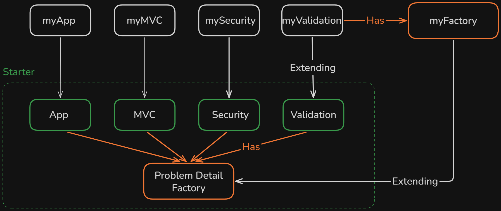

# Spring Boot Exception Handling Starter

## Modules

Provides several extendable modules for web application exception handling:
1. Security
2. Web MVC
3. Validation
4. App exceptions

All modules use ProblemDetailFactory(RFC 9457) that enforce defined by starter contract. Therefore, cannot be extended.

## Starter architecture



## Business Exception usage example

```java
        if (receipt.getStatus() != GoodsReceiptStatus.OPEN) {
            throw AppException.of(ReceivingErrorCode.RECEIPT_INVALID_STATE)
                    .with("expected_status", GoodsReceiptStatus.OPEN)
                    .with("actual_status", receipt.getStatus())
                    .with("receipt_id", receiptId);
        }
```

## Getting started
+ Add dependency (Maven)
```xml
        <dependency>
            <groupId>com.khinya</groupId>
            <artifactId>exception-handling-spring-boot-starter</artifactId>
            <version>0.0.1</version>
        </dependency>
```

+ Define message source in `application.yaml`

```yaml
  messages:
    basename: messages
    encoding: UTF-8
    fallback-to-system-locale: false
    use-code-as-default-message: true
```


